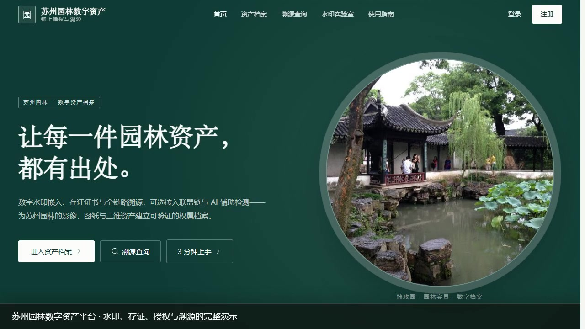
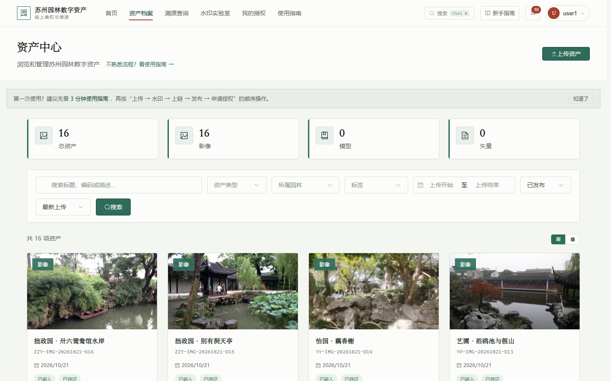
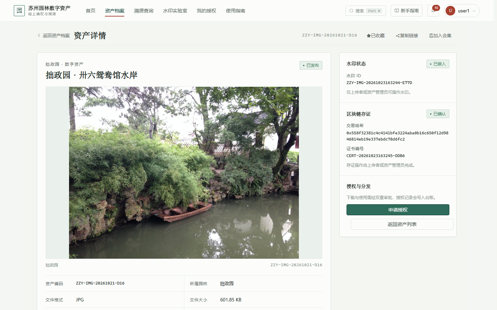
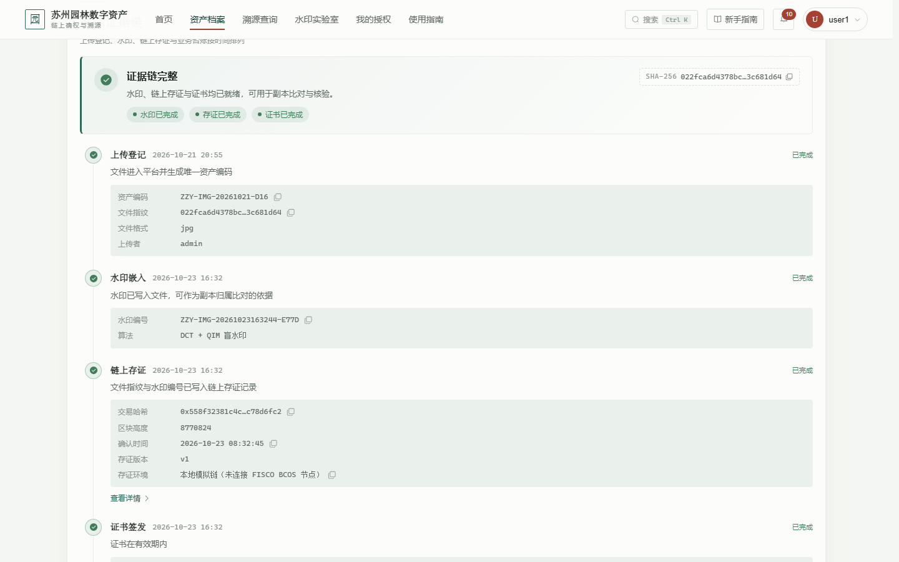
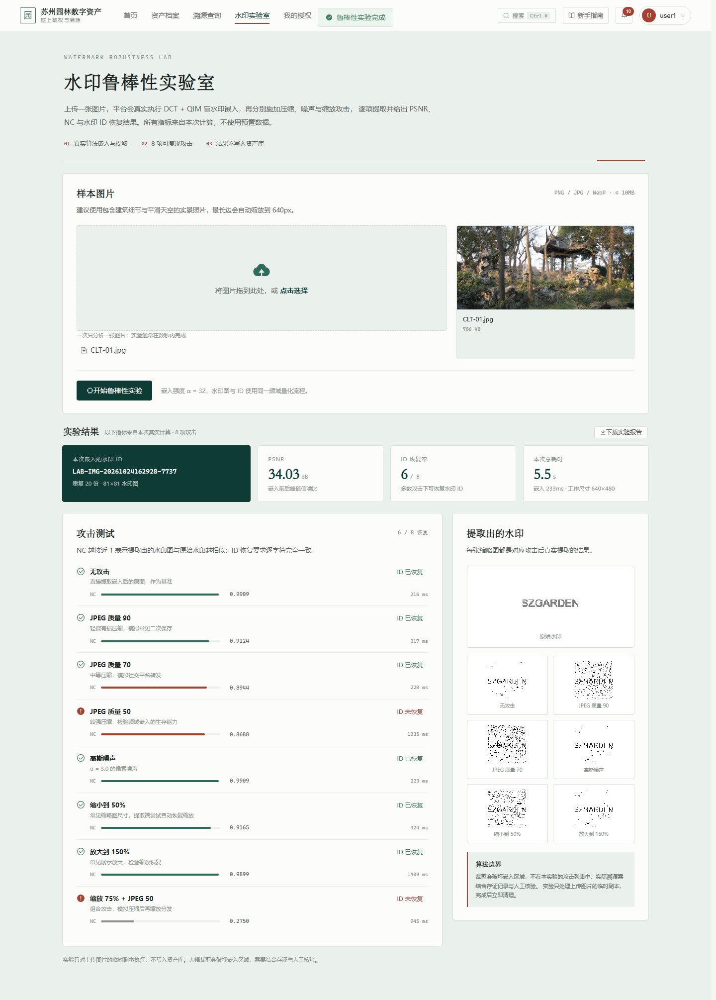
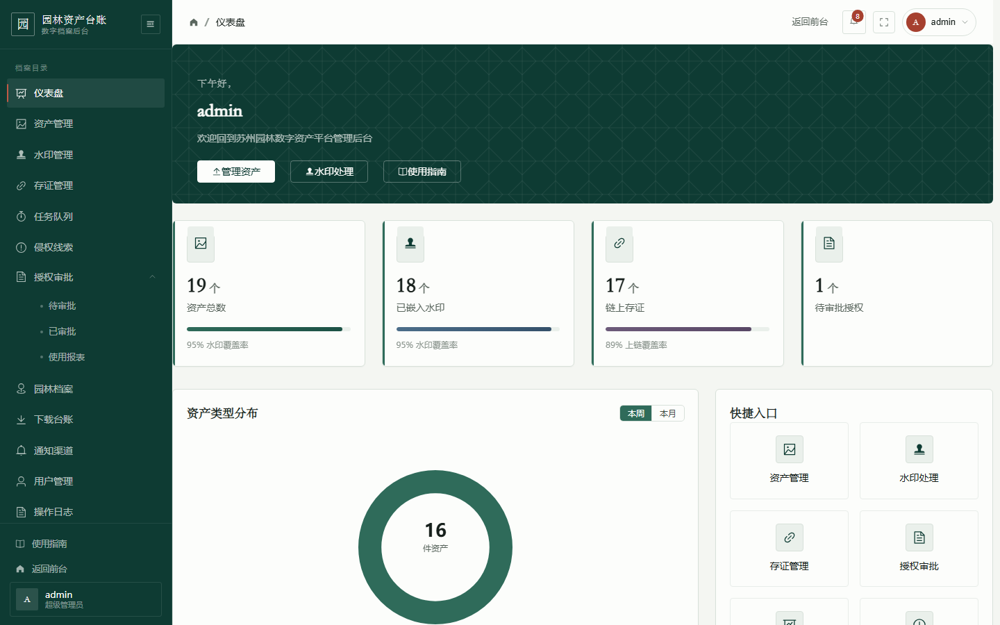
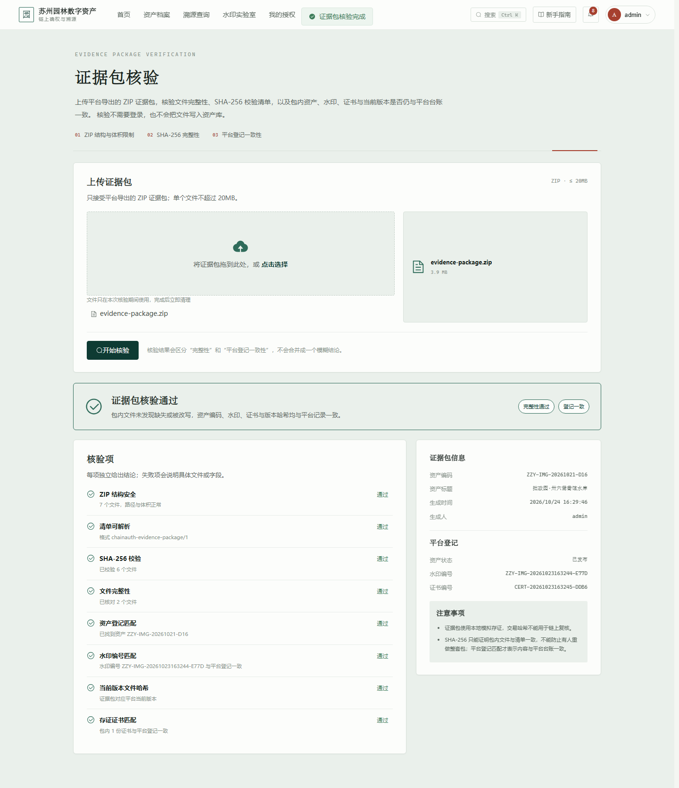

# 苏州园林数字资产安全分发与溯源系统

> 从"版权裸奔"到"链上确权"：基于数字水印和AI推理的苏州园林数字资产安全分发与溯源系统

## 项目简介

本系统面向苏州园林数字资产（图片、3D模型、矢量图纸等）的版权保护与安全分发需求，构建了**水印嵌入 → 存证记录 → 可选 AI 辅助 → 溯源追踪**的保护链路。默认使用本地模拟链与关闭 AI；正式接入 FISCO BCOS、模型与 OCR 需按部署文档额外配置。

> 哪些能力已真实可用、哪些仍是演示，以及下一阶段的重构计划，见 [能力完整性审计](docs/COMPLETENESS-AUDIT.md)。现场演示与验收流程见 [演示脚本](docs/DEMO-SCRIPT.md)。

## 演示

[](docs/assets/video/suzhou-garden-demo.mp4)

[观看完整演示视频（约 1 分钟）](docs/assets/video/suzhou-garden-demo.mp4) · [查看全部界面截图](docs/assets/screenshots/) · [素材说明与复现方式](docs/assets/README.md)

<details>
<summary>动态预览（GIF，约 2.8MB）</summary>


</details>

| 资产档案 | 资产详情 |
|----------|----------|
|  |  |
| **证据链** | **水印鲁棒性实验室** |
|  |  |
| **管理仪表盘** | **证据包公开核验** |
|  |  |

### 核心功能

| 模块 | 功能 | 技术实现 |
|------|------|----------|
| 资产管理 | 数字资产上传、浏览、分类、检索、下载；8MB+ 文件分块断点续传，刷新/换设备后可恢复未完成上传 | Vue3 + Flask + SQLite/PostgreSQL |
| 数字水印 | DCT + QIM 盲水印嵌入与提取，对 JPEG、噪声与 50%–150% 缩放具备恢复能力，具体以水印实验室实测为准；模型/文档/视频没有盲水印能力，按文件哈希与版本存证 | Python OpenCV + NumPy |
| 水印实验室 | 上传图片后真实执行嵌入与 8 项攻击，返回 PSNR、NC、水印 ID 恢复情况与每项耗时，可下载 Markdown 报告 | DCT/QIM + Flask + Vue3 |
| 区块链存证 | 按文件版本签发存证证书，支持历史版本证书追溯；默认本地模拟，可配置接入 FISCO BCOS | FISCO BCOS + Python SDK（可选） |
| 异步任务 | 水印/存证任务持久化入队，后台 worker 执行，支持进度查询、失败重试与超时对账；worker 心跳与队列健康度可观测 | Flask + 数据库队列 + 进程内/独立 worker |
| AI 辅助（可选） | 以图搜图、侵权辅助检测、智能问答；默认关闭，需安装模型与 API Key | CLIP + Milvus + 智谱 GLM（可选） |
| 授权分发 | 在线申请→双重审批→合同管理→下载控制；用途/渠道/格式/地域/下载次数作为可执行范围，授权绑定签发时的文件版本 | Vue3 + Flask |
| 下载指纹 | 授权用户下载影像时生成带资产编码、授权编号、账号与唯一指纹码的可见副本，原盲水印保留；台账可回溯 | Pillow + Flask |
| 大文件体验 | 下载、预览与分享下载均使用短时票据，浏览器直接流式读取或落盘，不再整包进入 JS 内存；超过 25MB 的预览需手动加载 | Flask + itsdangerous + send_file |
| 证据包导出 | 所有者/资产管理员一键打包当前版本原件与水印副本、证据链、版本证书、SHA-256 清单与核验说明；超出 200MB 时仅导出清单与证书 | Flask + ZIP |
| 证据包核验 | 公开上传 ZIP，独立核对结构、SHA-256、资产编码、水印、证书与当前/历史版本哈希，区分“完整性失败”与“登记不一致” | Flask + ZIP |
| 审计日志完整性 | 操作日志写入时计算服务端 HMAC-SHA256，后台可一键校验；字段被修改会标记异常，支持历史日志补签 | Flask + HMAC |
| 多格式预览 | 图片缩略图、视频在线播放、PDF 内嵌预览、三维模型（GLB/GLTF/STL/OBJ）旋转缩放；矢量数据提示下载后用 GIS 软件查看；预览按授权控制且不计下载量 | Vue3 + Flask + three.js |
| 侵权线索 | 公开提交疑似盗用文件/链接，水印匹配资产后进入后台研判，确认或驳回时通知举报人与权利人 | Vue3 + Flask |
| 通知渠道 | 站内 SSE 实时推送 + 可选 SMTP 邮件 + 系统 Webhook（兼容企业微信群机器人，支持签名与重试） | SSE + SMTP + Webhook |
| 协作与版本 | 评论/回复、影像区域标注、版本上传/恢复 | Vue3 + Flask |

### 技术架构

```
浏览器 ──→ Nginx ──→ Vue3 SPA (静态资源)
                      │
                      ├──→ Flask REST API ──→ PostgreSQL
                      │                    ├──→ Redis (缓存/限流)
                      │                    ├──→ MinIO (可选对象存储，当前默认本地磁盘)
                      │                    └──→ Milvus (向量检索)
                      │
                      ├──→ 异步任务 worker（水印/存证）──→ 同一数据库/上传目录
                      │
                      └──→ FISCO BCOS (区块链存证)
```

### 技术栈

| 层级 | 技术 |
|------|------|
| 前端 | Vue 3.5, Vite 8, Pinia, Element Plus, ECharts 6, three.js |
| 后端 | Flask 3.1, Flask-RESTful, SQLAlchemy 2, Flask-JWT-Extended |
| 存储 | PostgreSQL, Redis, Milvus；MinIO 为可选服务（当前默认本地磁盘） |
| 区块链 | FISCO BCOS 3.x（可选，默认本地模拟存证） |
| AI | CLIP / 智谱 GLM（可选，需自行安装与配置） |
| 部署 | Docker Compose, Gunicorn, Nginx |

## 快速开始

> 第一次使用建议先读 [使用指南](docs/USER-GUIDE.md)，或启动后访问 `/guide` 查看站内引导。

### 环境要求

- Python 3.11+ / Node.js 22+
- Docker & Docker Compose（推荐）

### Docker 一键部署

```bash
# 配置环境变量
cp .env.example .env
# 生成随机密钥，把输出替换 .env 里的 SECRET_KEY / JWT_SECRET_KEY 占位值
python backend/scripts/generate_secrets.py
# 编辑 .env，填入数据库密码等 Docker Compose 变量

# 启动所有服务（后端、任务 worker、前端、PostgreSQL、Redis、MinIO）
docker compose up -d

# 初始化数据库
docker exec garden-backend python scripts/init_db.py

# 填充示例数据（可选）
docker exec garden-backend python scripts/create_test_data.py
```

服务端口：
- 前端页面: http://localhost
- 后端API: http://localhost:5000/api
- MinIO控制台: http://localhost:9001
- 健康检查: http://localhost:5000/health

### 本地开发

**后端：**

```bash
cd backend
pip install -r requirements.txt
python scripts/init_db.py    # 初始化数据库
python run.py                # 启动开发服务器 :5000
```

**前端：**

```bash
cd frontend
npm install
npm run dev                  # 启动Vite开发服务器 :5173
```

### 数据库迁移

项目使用 Flask-Migrate / Alembic 管理表结构。新库直接执行：

```bash
cd backend
FLASK_APP=run.py flask db upgrade
```

`scripts/init_db.py` 已改为通过迁移建表；如果接入已有旧库（有表但没有 `alembic_version`），脚本会先 stamp 基线再执行后续迁移。手动处理旧库时：

```bash
FLASK_APP=run.py flask db stamp be3bcbd6313e
FLASK_APP=run.py flask db upgrade
```

### 运行测试

```bash
# 后端测试（395个用例，覆盖API/模型/安全/迁移/异步任务/worker健康度/版本证书/通知渠道/授权范围/授权视图/资产回收站/侵权线索/批量巡检/备份恢复/存储巡检/水印鲁棒性实验/证据包导出与核验/审计日志完整性/HTTP错误处理/对象级可见性/断点续传/魔数校验）
cd backend && python -m pytest tests/ -v

# Windows 内存受限时：逐文件隔离子进程运行（推荐）
cd backend && python scripts/run_tests.py

# 前端单元测试（54 个用例）
cd frontend && npm run test:ci

# Windows 内存受限时：逐文件运行前端测试
cd frontend && npm run test:ci:safe

# 前端生产构建
cd frontend && npm run build
```

### 默认账号

开发环境初始化后：管理员 `admin / admin123` · 审批员 `adm1, adm2 / 123456` · 用户 `user1, user2 / 123456`

> 生产环境（`FLASK_ENV=production`）初始化时不再创建 `123456` 演示账号；未设置 `ADMIN_INITIAL_PASSWORD` 会生成一次性随机管理员密码，并写入 `backend/instance/initial_admin_password.txt`（权限 600）。演示部署可显式设置 `SEED_DEMO_USERS=true`。正式部署前请立即修改管理员密码。

## 项目结构

```
garden-asset-platform/
├── backend/                        # Flask后端
│   ├── app/
│   │   ├── resources/             # API资源层（auth/asset/watermark/blockchain/ai/license/garden）
│   │   ├── models/                # 数据模型（User/Asset/Watermark/License/Garden/OperationLog）
│   │   ├── services/              # 业务服务层
│   │   │   ├── watermark_service.py    # DCT频域水印算法
│   │   │   ├── blockchain_service.py   # FISCO BCOS链交互
│   │   │   └── ai_service.py           # AI特征提取与问答
│   │   ├── utils/                 # 工具模块（日志/中间件/错误处理/JWT回调）
│   │   ├── config.py              # 多环境配置（开发/生产/测试）
│   │   └── __init__.py            # Flask应用工厂
│   ├── algorithm/                 # 水印算法库（DCT+QIM/矢量）
│   ├── contracts/                 # Solidity智能合约
│   ├── scripts/                   # 初始化与种子数据脚本
│   ├── migrations/                # Alembic 迁移（baseline + versions）
│   ├── tests/                     # pytest测试（395个用例）
│   ├── requirements.txt
│   └── Dockerfile
├── frontend/                       # Vue3前端
│   ├── src/
│   │   ├── views/                 # 页面组件
│   │   │   ├── home/              # 首页 + 登录 + 注册
│   │   │   ├── asset/             # 资产中心 + 详情 + 上传
│   │   │   ├── license/           # 申请授权 + 我的授权
│   │   │   ├── trace/             # 溯源查询 + 报告下载
│   │   │   ├── certificate/       # 区块链存证证书
│   │   │   ├── admin/             # 管理后台（仪表盘/资产/水印/授权/区块链/用户）
│   │   │   ├── profile/           # 个人中心
│   │   │   ├── settings/          # 账号设置
│   │   │   └── error/             # 404页面
│   │   ├── api/                   # API请求封装（8个模块）
│   │   ├── stores/                # Pinia状态管理
│   │   ├── router/                # Vue Router路由 + 权限守卫
│   │   └── assets/                # 样式变量 + 全局样式
│   ├── Dockerfile
│   └── nginx.conf
├── docs/                           # 使用指南、演示脚本、能力审计与验收素材
│   └── assets/                     # 17 张界面截图 + 演示视频/GIF/封面
├── docker-compose.yml              # 多服务编排
├── Dockerfile                      # 一体化构建
└── .gitignore
```

## API 概览

### 公开接口（无需认证）

| 方法 | 路径 | 说明 |
|------|------|------|
| GET | `/api/stats` | 平台统计数据（资产数、上链数等） |
| POST | `/api/register` | 用户注册 |
| POST | `/api/login` | 用户登录 |
| POST | `/api/refresh` | 刷新Access Token |
| POST | `/api/forgot-password` | 请求密码重置邮件（不泄露邮箱是否注册；开发环境可返回调试链接） |
| POST | `/api/reset-password` | 使用一次性链接重置密码（30 分钟有效，重置后旧 Token 失效） |
| POST | `/api/verify-email` | 使用邮件链接验证邮箱 |
| POST | `/api/verify-email/send` | 发送邮箱验证邮件（需登录，限流） |

### 资产模块（需认证）

| 方法 | 路径 | 说明 |
|------|------|------|
| GET | `/api/assets` | 资产列表（分页、筛选、搜索） |
| POST | `/api/assets/upload` | 上传资产（含魔数校验） |
| POST | `/api/assets/upload/session` | 创建断点续传会话（8MB+ 文件分块上传） |
| GET | `/api/assets/upload/sessions` | 列出当前用户未完成的上传会话（刷新页面/换设备后可恢复） |
| GET/PUT/PATCH/DELETE | `/api/assets/upload/session/:upload_id` | 查询已接收偏移 / 追加分块（`X-Upload-Offset`）/ 续传前同步元数据 / 放弃并清理临时文件 |
| POST | `/api/assets/upload/session/:upload_id/complete` | 合并分块、校验并创建资产 |
| GET | `/api/assets/:id` | 资产详情 |
| PUT | `/api/assets/:id` | 编辑标题、著录说明与标签（所有者/资产管理员，标签整体替换） |
| POST | `/api/assets/:id/restore` | 恢复已删除资产为草稿（所有者/资产管理员） |
| GET | `/api/assets/:id/download` | 下载资产（授权用户需传 `purpose`/`territory` 申报范围；影像会生成可见指纹副本，响应头 `X-Download-Fingerprint`；也接受短时 `ticket` 参数） |
| POST | `/api/assets/:id/download-ticket` | 申请 120 秒短时下载票据（绑定资产/用户/用途/地域），浏览器可凭票据直接流式下载大文件 |
| GET | `/api/assets/stats` | 资产统计（含水印趋势） |
| GET | `/api/assets/my` | 我的资产 |
| GET | `/api/assets/:id/thumbnail` | 资产缩略图（`?size=card` 返回列表卡片图） |
| GET | `/api/assets/:id/preview` | 在线预览（视频/PDF/GLB/GLTF/STL/OBJ；已发布资产需有效授权；不计下载量；也接受短时 `ticket` 参数并支持 Range） |
| POST | `/api/assets/:id/preview-ticket` | 申请预览票据（默认 1 小时），供 video/iframe/三维加载器直接流式读取 |
| GET | `/api/assets/:id/related` | 同园林相关资产 |
| GET | `/api/assets/:id/licenses` | 资产所有者/管理员查看该资产的授权与申请记录（含被授权方、配额、到期） |
| GET | `/api/assets/:id/evidence` | 资产证据链（上传/水印/存证/证书/发布/授权/下载） |
| GET | `/api/assets/:id/evidence-package` | 导出证据包 ZIP（所有者/资产管理员；`include_files=0` 仅导出清单） |
| POST | `/api/evidence/verify-package` | 公开核验证据包 ZIP（结构、SHA-256、平台资产/水印/证书/版本） |
| GET/POST | `/api/assets/:id/versions` | 版本历史（含各版本证书）/ 上传新版本（文件替换并重置水印与当前存证） |
| GET | `/api/assets/:id/versions/:version_id/download` | 下载指定历史版本 |
| POST | `/api/assets/:id/versions/:version_id/restore` | 恢复历史版本（生成新版本，不删除历史） |
| GET/POST | `/api/assets/:id/comments` | 评论列表 / 发表评论或回复 |
| PUT/DELETE | `/api/assets/:id/comments/:comment_id` | 编辑 / 删除评论 |
| GET/POST | `/api/assets/:id/annotations` | 区域标注列表 / 新增标注 |
| PUT/DELETE | `/api/assets/:id/annotations/:annotation_id` | 更新状态或内容 / 删除标注 |
| GET/POST | `/api/assets/:id/shares` | 查询/创建公开分享链接（有效期、访问码、下载权限） |
| GET | `/api/shares/:token` | 公开分享页数据（免登录，返回资产与证据链） |
| GET | `/api/shares/:token/download` | 通过分享链接下载（受访问码、下载开关与次数限制；也接受短时 `ticket`） |
| POST | `/api/shares/:token/download-ticket` | 校验访问码后签发 120 秒分享下载票据，浏览器直接流式取件 |
| DELETE | `/api/shares/:id` | 撤销分享链接 |
| GET/POST/DELETE | `/api/assets/:id/favorite` | 查询/添加/取消收藏 |
| GET | `/api/favorites` | 我的收藏列表 |
| GET | `/api/tags` | 已发布资产的标签及数量分面 |
| GET | `/api/downloads/my` | 我的下载记录 |
| GET | `/api/downloads` | 全平台下载台账（管理员，支持筛选与汇总） |
| GET | `/api/assets/:id/downloads` | 单件资产下载摘要（所有者/管理员） |
| GET/POST | `/api/collections` | 我的合集列表 / 新建合集 |
| GET/PUT/DELETE | `/api/collections/:id` | 合集详情 / 编辑 / 删除 |
| POST | `/api/collections/:id/assets` | 批量加入资产 |
| DELETE | `/api/collections/:id/assets/:asset_id` | 从合集移除资产 |
| GET/POST | `/api/gardens` | 园林列表 / 新建园林档案（管理员） |
| PUT/DELETE | `/api/gardens/:id` | 编辑 / 删除园林档案（管理员，仍有资产时拒绝删除） |

### 水印与溯源

| 方法 | 路径 | 说明 |
|------|------|------|
| POST | `/api/watermark/embed` | 嵌入水印（`async: true` 时入队并返回任务 ID） |
| POST | `/api/watermark/extract` | 提取水印 |
| POST | `/api/watermark/verify` | 验证水印ID |
| POST | `/api/watermark/trace` | 图片溯源查询 |
| POST | `/api/watermark/benchmark` | 水印鲁棒性实验（需登录：真实嵌入 + JPEG/噪声/缩放攻击，返回 PSNR/NC/ID 恢复） |
| GET | `/api/watermark/logs` | 水印操作日志 |

### 区块链存证

| 方法 | 路径 | 说明 |
|------|------|------|
| POST | `/api/blockchain/register` | 资产上链存证（按当前文件版本签发证书；`async: true` 时入队） |
| POST | `/api/blockchain/verify` | 链上验证 |
| GET | `/api/blockchain/certificate/:id` | 获取存证证书（含对应版本与是否为当前版本） |
| GET | `/api/blockchain/history/:id` | 存证历史追溯 |
| GET | `/api/blockchain/status` | 区块链连接状态 |

### 异步任务

| 方法 | 路径 | 说明 |
|------|------|------|
| GET | `/api/tasks` | 任务列表（`asset_id`/`status` 筛选；非管理员仅看自己的任务） |
| GET | `/api/tasks/health` | 队列健康度与 worker 心跳（管理员：在线 worker、积压、超时处理与告警） |
| GET | `/api/tasks/:id` | 任务详情与进度 |
| POST | `/api/tasks/:id/retry` | 重试失败/已取消任务 |
| POST | `/api/tasks/:id/cancel` | 取消排队中的任务 |

> 生产部署由 `worker` 容器执行 `flask tasks run`；开发环境默认启动进程内 worker。可用 `flask tasks list` 与 `flask tasks reconcile` 排查队列。

### AI能力

| 方法 | 路径 | 说明 |
|------|------|------|
| POST | `/api/ai/analyze` | AI资产特征分析 |
| POST | `/api/ai/search` | 以图搜图相似资产 |
| POST | `/api/ai/infringement` | 侵权检测 |
| POST | `/api/ai/chat` | AI智能问答助手 |

### 待办与审计

| 方法 | 路径 | 说明 |
|------|------|------|
| GET | `/api/notifications` | 当前用户的待办提醒（审批、申请状态、到期），含未读数与已读状态 |
| POST | `/api/notifications/read` | 标记单条或全部待办为已读 |
| GET/PUT | `/api/notifications/preferences` | 邮件通知开关与事件分组偏好 |
| POST | `/api/notifications/test-email` | 向当前用户邮箱发送测试邮件（需配置 SMTP） |
| GET | `/api/notifications/stream` | SSE 实时通知流（Authorization 头鉴权，`since_id` 补发） |

### 侵权线索

| 方法 | 路径 | 说明 |
|------|------|------|
| POST | `/api/infringements/report` | 提交疑似侵权线索（可匿名；文件可选，服务端尝试水印匹配） |
| POST | `/api/infringements/patrol` | 批量巡检：上传多个疑似副本，异步提取水印并自动生成线索 |
| GET | `/api/infringements/mine` | 我提交的线索与处理状态 |
| GET | `/api/infringements` | 后台线索列表（状态/关键词/日期筛选与计数） |
| GET | `/api/infringements/:id` | 线索详情与可处理状态 |
| POST | `/api/infringements/:id/review` | 受理/确认/驳回（确认与驳回通知举报人与权利人） |
| GET | `/api/infringements/:id/file` | 下载举报文件（管理员） |
| GET | `/api/logs` | 操作日志（管理员，支持模块/结果/日期/关键词筛选） |
| GET | `/api/logs/integrity` | 校验操作日志 HMAC 完整性（管理员） |
| GET | `/api/system/status` | 系统能力状态（管理员：AI/链/Redis/调度器/通知/存储真实启用情况） |
| GET | `/api/system/storage` | 存储占用与孤儿文件报告（管理员，只读，不删除） |
| GET/PUT | `/api/system/notification-webhook` | 系统 Webhook 配置（管理员） |
| POST | `/api/system/notification-webhook/test` | 发送测试 Webhook |

### 授权管理

| 方法 | 路径 | 说明 |
|------|------|------|
| POST | `/api/license/apply` | 申请使用授权（支持 `usage_purpose_code`、`allowed_channels`、`allowed_formats`、`max_downloads`、`territory`） |
| GET | `/api/license/pending` | 待审批列表（审批员） |
| POST | `/api/license/approve/:id` | 审批（通过/拒绝） |
| GET | `/api/license/approved` | 已审批列表 |
| GET | `/api/license/my` | 我的授权 |
| GET | `/api/license/my-applications` | 我的申请 |
| POST | `/api/license/applications/:id/cancel` | 撤回申请 |
| POST | `/api/license/:id/revoke` | 撤销授权（授权方/资产所有者/授权管理员） |
| POST | `/api/license/:id/renew` | 授权续期 |
| GET | `/api/license/usage-report` | 授权使用报表（状态、配额、拒绝原因、版本过期、趋势） |
| GET | `/api/license/:id/contract` | 查看授权合同 |

## 安全特性

- 生产配置强制校验 `SECRET_KEY`/`JWT_SECRET_KEY`：示例占位文本或不足 32 位时拒绝启动
- JWT双Token认证（Access 24h + Refresh 30d）；登出同时撤销 refresh token，改密/重置密码后旧 token 立即失效
- 非 debug 模式下缺失/过期/撤销的 Token 统一返回 401，不会因 Flask-RESTful 异常接管变成 500
- 对象级可见性：证书、存证历史、标签、收藏与公开接口统一检查资产状态；草稿证据仅所有者/管理员可见，全平台证书列表仅管理员可读，公开链状态不返回 RPC 地址
- 请求频率限制（Redis计数器，可配置阈值；Redis异常不影响业务执行）
- 文件上传魔数字节校验（26 种允许扩展名，含 MP4/MOV/MKV、Office、CAD、GLTF/FBX；0 字节文件直接拒绝）
- 文件大小限制（继承Flask MAX_CONTENT_LENGTH）
- Content-Security-Policy响应头（生产模式；PDF 预览接口单独放行同源 iframe）
- X-Content-Type-Options / X-Frame-Options / X-XSS-Protection（预览外一律 DENY）
- SQL注入防护（SQLAlchemy参数化查询）
- 生产环境堆栈信息不泄露
- 角色权限控制（admin / asset_admin / license_admin / adm1 / adm2 / user）

## 环境变量

Docker 部署见 `garden-asset-platform/.env.example`；本地开发见 `backend/.env.example`。关键配置项：

| 变量 | 说明 | 默认值 |
|------|------|--------|
| `SECRET_KEY` | Flask密钥（生产需 ≥32 位随机值，拒绝示例占位文本） | - |
| `JWT_SECRET_KEY` | JWT签名密钥（同样校验强度） | - |
| `DATABASE_URL` | 数据库连接串 | `sqlite:///garden_asset.db` |
| `REDIS_URL` | Redis连接串 | `redis://localhost:6379/0` |
| `BLOCKCHAIN_ENABLED` | 启用区块链 | `false` |
| `AI_ENABLED` | 启用AI功能 | `false` |
| `ZHIPU_API_KEY` | 智谱AI密钥 | - |
| `BAIDU_OCR_API_KEY` | 百度OCR密钥 | - |
| `ADMIN_INITIAL_PASSWORD` | 初始化脚本创建 admin 时使用的密码 | `admin123`（仅演示） |
| `TRUST_PROXY_HEADERS` | 是否信任反向代理的 `X-Forwarded-For`（仅在后端不直接暴露时开启） | `false` |
| `TASK_WORKER_ENABLED` | 是否在 API 进程内启动异步任务 worker（开发默认开，生产建议关） | `false` |
| `TASK_MAX_ATTEMPTS` | 异步任务最大尝试次数 | `3` |
| `TASK_STUCK_TIMEOUT_MINUTES` | 多久未完成的 running 任务视为超时并重新排队 | `15` |
| `TASK_WORKER_STALE_SECONDS` | worker 心跳超过该秒数未刷新视为离线 | `90` |
| `TASK_BACKLOG_THRESHOLD` | 排队任务达到该数量时健康度降为 warning | `50` |
| `TASK_WORKER_POLL_INTERVAL` | worker 空闲轮询间隔（秒） | `1.0` |
| `SSE_ENABLED` | 是否启用站内 SSE 实时通知 | `true` |
| `SSE_MAX_SECONDS` | 单个 SSE 连接最长保持秒数 | `300` |
| `SSE_MAX_CONNECTIONS_PER_USER` | 单用户同时保留的 SSE 连接上限 | `3` |
| `MAIL_ENABLED` | 是否启用邮件通知 | `false` |
| `MAIL_HOST` / `MAIL_PORT` | SMTP 主机与端口 | - / `587` |
| `MAIL_USERNAME` / `MAIL_PASSWORD` | SMTP 登录凭据 | - |
| `MAIL_FROM` | 发件人地址 | 同 `MAIL_USERNAME` |
| `MAIL_USE_TLS` / `MAIL_USE_SSL` | SMTP 加密方式 | `true` / `false` |
| `PUBLIC_BASE_URL` | 邮件中链接使用的前端地址 | `http://localhost:5173` |
| `WEBHOOK_ALLOW_PRIVATE` | 是否允许 Webhook 指向内网地址（默认拒绝以防 SSRF） | `false` |
| `BACKUP_DIR` | 数据库备份目录 | `./backups` |
| `EVIDENCE_PACKAGE_MAX_BYTES` | 证据包允许打包的二进制总大小，超出时仅导出清单与证书 | `209715200`（200MB） |
| `EVIDENCE_VERIFY_MAX_BYTES` | 证据包核验上传大小上限 | `20971520`（20MB） |
| `DOWNLOAD_TICKET_MAX_AGE` | 下载票据有效期（秒），过期需重新申请 | `120` |
| `RESUMABLE_CHUNK_SIZE` | 断点续传分块大小（字节） | `4194304`（4MB） |
| `UPLOAD_SESSION_TTL_HOURS` | 未完成上传会话保留小时数，超时自动标记过期并清理临时文件 | `48` |
| `PREVIEW_TICKET_MAX_AGE` | 预览票据有效期（秒），需覆盖一次播放/阅读会话 | `3600` |
| `SHARE_TICKET_MAX_AGE` | 公开分享下载票据有效期（秒） | `120` |
| `AUDIT_HMAC_KEY` | 审计日志 HMAC 密钥；留空时回退到 `SECRET_KEY` | 空 |

> 多 worker 部署（4 个 gunicorn worker）默认关闭任务调度器，避免备份/授权过期任务重复执行。如需启用，设置 `SCHEDULER_ENABLED=true`，并确保只运行一个调度进程（或改用外部 cron）。

> 水印与存证任务默认进入 `async_tasks` 表，由 `docker compose` 中的 `worker` 服务执行；开发环境由 API 进程内 worker 执行。任务领取使用条件更新，多 worker 并发也不会重复处理。worker 每次轮询写入 `worker_heartbeats`，后台“任务队列”页展示在线 worker、积压与超时告警；也可运行 `flask tasks status`（`--check` 在无在线 worker 或健康度异常时返回非零，compose worker 已用作健康检查）。

> 备份目录默认 `backend/backups`（Docker 挂载为 `/app/backups`）。使用 `flask backup create`、`flask backup list`、`flask backup restore <文件名>`；SQLite 恢复前会自动保留 `pre_restore_*.db` 回滚副本。生产环境仍建议定期把备份复制到独立存储并做恢复演练。

> 存储巡检使用 `flask storage report`（可加 `--min-age-hours`、`--limit`）：统计上传/水印/提取目录占用，并列出数据库未引用且超过保护期的文件。该命令只读，不会自动删除文件；确认清单后再按部署流程清理。

> 站内实时通知使用 SSE，Docker 后端已切换为 `gthread` worker 并放宽超时；每个在线连接占用一个线程。大规模部署建议改用 Redis Pub/Sub + gevent/eventlet，或把 SSE 拆成独立服务。邮件通知默认关闭，配置 `MAIL_ENABLED`/`MAIL_HOST` 后由 worker 每分钟派发。

> 文件默认保存在 `backend/uploads/`（Docker 中为挂载卷）。`docker-compose.yml` 中的 MinIO 服务为可选组件，当前版本尚未接入对象存储后端。

> AI 对话 SDK `zhipuai` 的元数据要求 `pyjwt<2.9`，与安全版 PyJWT（≥2.11）冲突，因此不在核心依赖中。需要 GLM 对话时执行：`pip install --no-deps zhipuai==2.0.1 httpx pydantic cachetools`。

## 许可证

MIT License
